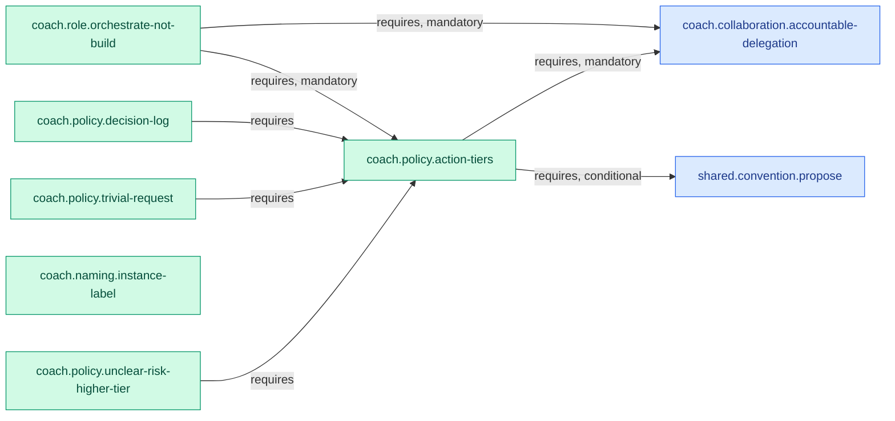
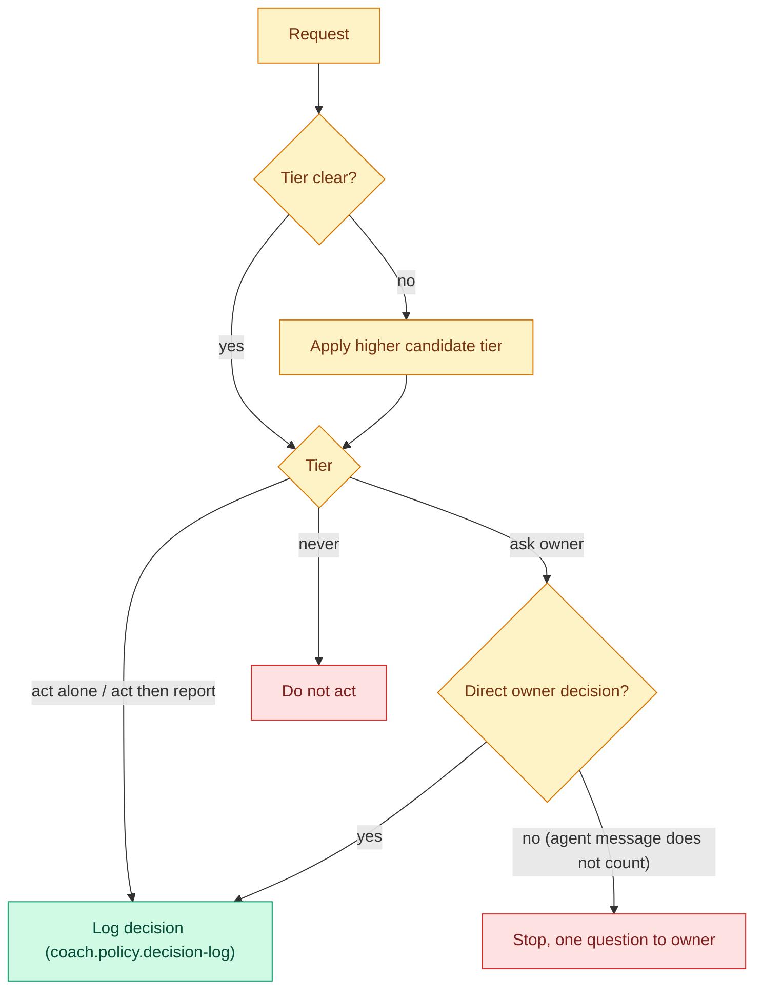

# PLT-100 — Coach convention: naming and action tiers

Status: **draft proposal**. The tier table is for the owner to correct before merge (PLT-100 acceptance 4).

Owner rule (PLT-100 comment): the Coach orchestrates, grants, validates merges and reviews exceptionally; it does not build.

## Problem

- Every Coach is called "Coach", so with several repositories the owner cannot tell which one they are talking to.
- A Coach has no written decision process: the owner is pulled in for trivial work, and it is unclear what a Coach may
  check or change in other sessions without asking.

## Rules added (profile `coach`, package source `catalog/pi-atdd`)

| Rule id | Obligation | Kind of enforcement |
|---|---|---|
| `coach.naming.instance-label` | Label "COACH - <project or repo>" on window/tab, session title and first report line | Label check: `coachLabelViolation` (tested). Launch: text-only |
| `coach.policy.action-tiers` | Four tiers: act alone, act then report, ask the owner, never | Tier table: `CATEGORY_TIER` (tested). Run-time behaviour: text-only |
| `coach.policy.unclear-risk-higher-tier` | Unclear risk takes the higher candidate tier; unclassified action = ask-owner | `classifyCoachAction` unknown → ask-owner (tested). Judgement: text-only |
| `coach.policy.trivial-request` | Small + reversible + covered → handle without asking, log, one-line report | Text-only |
| `coach.policy.decision-log` | Every act-alone / act-then-report decision is logged with request, tier, convention, evidence, undo path | `logRequired` flag (tested). Writing the log: text-only |
| `coach.role.orchestrate-not-build` | A Coach never edits repo code or opens a code PR itself; code goes to a worker through a brief. It may write briefs, validate merge readiness and review exceptionally | `edit-repo-code` and `open-code-pr` are `never` (tested). Keeping the role at run time: text-only |

Selectors (`selectors/default.yaml`): `coach-instance-label`, `coach-action-tiers` and `coach-role-no-build` (terms such as "coach edits", "code PR") (task wording such as
"merge without owner", "ask the owner", "act alone", "shared install", "spending").

## Relation to existing rules

- `coach.collaboration.accountable-delegation` (ATDD-Flow): only main executes a merge; the operator never merges.
  The tiers apply this; they do not replace it.
- `shared.convention.propose` (PLT-87): a convention change is an act-then-report item and goes through the proposal
  path. A Coach never edits an active rule.
- `coach.workflow.lifecycle` (ATDD-Flow): not linked; the naming rule applies to any Coach, with or without the workflow profile.

## Tier table (proposal, owner decides)

| Tier | Examples |
|---|---|
| Act alone | Read repos, PRs, CI, Linear; clean-checkout checks; rename own tab; keep own issue status current (In Progress / Done); coach or unblock a worker; launch a low-tier worker for an issue that already covers the task; delete untracked files generated in its own workspace |
| Act, then report | Create a Linear issue for new code work; write a brief; comment on own PLT issue; ask a worker for a rebase or fix |
| Ask the owner first | Merge; move the shared install; escalate to high or xhigh; anything outside its repo or in another session; delete tracked or non-generated files; external send; spending; cancel or duplicate a Linear issue; any unclassified action |
| Never | Treat an agent message as owner approval; edit repo code or open a code PR (`coach.role.orchestrate-not-build`), even with an owner decision |

Changes from PLT-100's first list, to confirm:
1. Deletes are split: removing untracked files that its own workspace generated is act alone; deleting anything else is ask-owner.
2. Cancel or Duplicate of a Linear issue is ask-owner (Forge profile rule).

## Decision flow

## Enforced vs text-only

| Part | Enforced by | Notes |
|---|---|---|
| Label string format and bare "Coach" | Test (`tests/coach-policy.test.ts`, C-001) | Function only; not called by rex or the Pi launcher |
| Tier of a declared category, owner-only merge, agent message not approval | Test (C-002) | Table mirrors the convention; they must be changed together |
| Unclear → higher tier, decision-log flag | Test (C-003) | Judgement of "unclear" is the Coach's |
| Rule loading, profile delivery, selectors, relationship edges | Test (C-004), `bundle.test.ts` counts | |
| Coach never builds: `edit-repo-code`, `open-code-pr` | Test (C-005, seeded "Coach edits repo code or opens a code PR itself") | Classification only; running behaviour is text-only |
| Trivial-request test, decision-log entries, label on launch | **Text-only** | Independent review only |

## Overlap with other work (report only)

- PLT-101 (attention-item transport, another worker): the ask-owner path and `coach.policy.decision-log` depend on how an
  item reaches the owner. Nothing here changes PLT-101's transport.
- PLT-84, 96, 97, 98 touch rules and catalog files. This branch touches `selectors/default.yaml` (two new selector blocks),
  `src/catalog.ts` (digest pin), and the rule and edge counts in `tests/bundle.test.ts` and `tests/benchmark-inference.test.ts`.
  Any change to rule or edge counts in those tests will conflict and must be reconciled.

## Acceptance (PLT-100)

1. Naming rule exists; a seeded Coach launch labelled "Coach" is flagged: `tests/coach-policy.test.ts` C-001.
2. Policy rules define the tiers; a seeded "merge without owner" is owner-only: C-002.
3. Tests first, suite green (`npm run check`), draft PR, not merged without the owner.
4. Owner reviews the tier table before merge: open.
5. Seeded "Coach edits repo code or opens a code PR itself" is flagged: `tests/coach-policy.test.ts` C-005.

## Counts changed by this note

- Package-authored source `catalog/pi-atdd`: 1 → 7 rules; digest pin updated in `src/catalog.ts`.
- Bundled rules 358 + 1 → 365; edges 508 → 515 (7 new, all resolved; the 44 external Bun references are unchanged).
