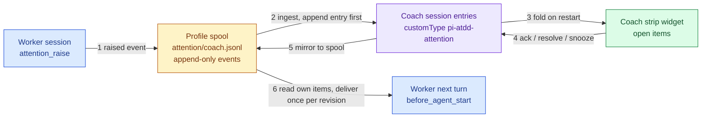

# PLT-101 — Attention Strip (design note)

Status: **approved by owner; Coach sent BUILD.** Decisions D1, Q1–Q4 below are final.
Scope: typed worker→Coach attention items inside the existing `pi-atdd` extension
(`extensions/atdd.ts` → `src/pi-activation.ts`). No new extension, no dependency, no hosted service.
This note is design input, not a compliance verdict. ATDD applicability for this task is UNKNOWN
(phase, actor_role and acceptance are unresolved; 44 external graph edges are unresolved).

## What exists today (read before design)

| Need | Existing pattern in `src/pi-activation.ts` | Reuse |
|---|---|---|
| Register commands | `pi.registerCommand("atdd", …)` | `/attention` inspection and manual ack/resolve/snooze |
| Persist state | Not used yet. Pi API: `pi.appendEntry(customType, data)` (hidden, not in LLM context) | Coach strip rebuild |
| Restore on resume | `session_start` / `session_tree` → `restoreFromBranch(ctx)` reads `ctx.sessionManager.getBranch()` | Same hook, folds attention entries |
| Inject context next turn | `before_agent_start` returns `{message:{customType, content, display:false}}` | Worker sees resolution on next turn |
| Delivery de-dup | `delivered` Map keyed by scope + digest | Same idea: deliver a resolution once per revision |
| Trust gate | `if(!ctx.isProjectTrusted()) return;` on every hook | Same gate on all attention hooks |
| Tools | Extension registers no tools yet; Pi API `pi.registerTool({…})` | Worker API (new, one file) |
| Widget | None yet; Pi API `ctx.ui.setWidget(key, lines, {placement:"aboveEditor"})` | Coach strip |

Hard rule kept from the existing code: an authenticated role is never inferred from chat text.

## Item schema

```ts
type AttentionType = "decision" | "grant" | "review" | "intervention";
type AttentionState = "open" | "acked" | "snoozed" | "resolved" | "cancelled" | "expired";

type AttentionItem = {
  id: string;             // "ati_" + 12 hex, generated by the extension
  type: AttentionType;    // closed enum, validated
  from: string;           // worker identity, stamped from launch config (never from tool args)
  profile: string;        // Pi profile of the worker, from launch config
  issue: string | null;   // Linear identifier, e.g. "PLT-101"; optional
  summary: string;        // one line, max 280 chars
  state: AttentionState;
  createdAt: string;      // ISO-8601
  ttl: string;            // ISO-8601 expiry; default createdAt + 72h, max 7d
  snoozedUntil?: string;  // only when state = snoozed
  resolution?: { by: string; note: string; at: string };
  revision: number;       // monotonic per item; used for worker delivery de-dup
};
```

Meaning of the types:
- `decision`: the worker needs the Coach to choose between options.
- `grant`: the worker needs permission for an action covered by the Coach grant (see PLT-100 overlap).
- `review`: the worker has something ready for Coach review.
- `intervention`: the worker is blocked or drifting and needs the Coach to act.

## Worker API (tools registered by the extension in worker sessions)

| Tool | Params | Returns |
|---|---|---|
| `attention_raise` | `type`, `summary`, `issue?`, `ttl?` | `{id, state:"open", ttl}` |
| `attention_status` | `id?` | items raised by **this** worker, with current state and resolution |

- `from` and `profile` are read from launch config (env set by the launcher), not from arguments.
  A worker cannot raise as another worker.
- Tools are registered only when the launch config says `role=worker`.
- `attention_status` never returns another worker's items.

## Coach strip (Coach sessions only)

- **Widget**: `ctx.ui.setWidget("pi-atdd-attention", lines, {placement:"aboveEditor"})`. Shows open,
  acked and snoozed items, sorted by type then age. Cleared (`undefined`) when the list is empty.
- **Actions**: `ack`, `resolve`, `snooze <until>`, `cancel`, plus ATD-35 `reassign` and `reopen` (Coach only). Exposed as
  - Coach agent tools `attention_ack`, `attention_resolve`, `attention_snooze`, `attention_reassign` (`id`, `toCoach`, `note`)
    and `attention_reopen` (`id`, `note`) (for the Coach agent), and
  - `/attention ack|resolve|snooze|cancel <id> [...]` (for the owner, typed in the Coach pane).
- `resolve` requires a note (one line). `cancelled` is set only by the Coach; never by a worker.
- **Reassign and reopen (ATD-35)**: a routed Coach can reassign an open item it holds to another Coach of the same
  project (`reassigned` signed record, with `reassignTo` and a required note). The item leaves the giving Coach's list
  and is open on the target's list; the worker sees the move. A Coach can reopen a `resolved` item it holds (`reopened`
  signed record); it returns to open and the worker is told. Cancelled and expired items cannot be reopened. Routing is
  unchanged: a Coach still cannot see or act on an item it does not hold. Visibility is decided from the authenticated
  history: a Coach sees an item on its current route, a worker on the route the item was raised on.
- **Q4 (owner decision, final)**: the Coach agent MAY resolve items **within its grant**
  (`scope: "within_grant"`). For anything **above its grant** it asks the owner first, then resolves with
  `scope: "owner_answer"` and `ownerAnswer: <owner's answer>`. The owner's answer is recorded in the resolution note
  and delivered to the worker. Enforced in code: `owner_answer` without a non-empty `ownerAnswer` is rejected.
  Text-only: that the Coach really asked the owner before using `owner_answer`.
- Refresh: on `before_agent_start`, on each `/attention`, and on a 5 s mtime poll of the spool file
  (timer cleared in `session_shutdown`, because the captured `ctx` goes stale after a session switch).

## Hidden custom session entries and restart rebuild

- Every state change is persisted as `pi.appendEntry("pi-atdd-attention", {event})`.
  Entries are hidden and not sent to the LLM.
- Event shape: `{event:"raised"|"state"|"ingested"|"delivered", …}`. `state` carries `id`, `revision`, `state`, `by`, `note`, `scope?`, `ownerAnswer?`, `snoozedUntil?`, `at`.
- **Rebuild** on `session_start` / `session_tree`:
  1. Read `ctx.sessionManager.getBranch()`, keep entries with `customType === "pi-atdd-attention"`.
  2. Fold by `id`, highest `revision` wins.
  3. Drop `resolved`, `cancelled`, `expired` and items past `ttl`.
  4. Keep `snoozed` items with their `snoozedUntil`.
- Acceptance point 3 holds because the Coach appends the entry **before** it writes the spool event.
  Entries alone are enough to rebuild the open set; the spool only adds items not yet ingested.

## How the worker sees the resolution on its next turn

Transport between two Pi sessions needs one channel. Proposed (**open decision D1**, see below):



- Worker side: `before_agent_start` reads the spool, selects items with `from === self` and
  `revision > cursor`, and returns `{message:{customType:"pi-atdd-attention-resolution", display:false, content}}`.
  The worker's delivery cursor is stored as a hidden `cursor` entry in the worker session, so a restart does not
  re-deliver.
- Delivery happens at the next `before_agent_start`, not mid-run. Mid-run delivery needs `steer` and is out of scope.
- `agent-say` is never required. It stays an optional nudge.

## TTL and cleanup

- `ttl` is checked on rebuild and on each refresh. Expiry is computed from `ttl` on every fold, so it needs no event. Expired items leave memory and are not delivered.
- Resolved, cancelled and expired items leave operational memory (strip and rebuild).
- Pi session entries are append-only. Old events remain in the session file, hidden and ignored by the fold.
  Physical removal would need editing the session file, which this design does not do. Stated as a retention fact.
- Spool compaction (GC): **deferred to a later issue (Q3, owner decision)**. Not in this change.

## Profile boundaries

- Spool path is under the **profile's own** agent dir (`<agentDir>/attention/`). Worker and Coach must have the same
  profile; the extension rejects events whose `profile` differs from its own.
- Launch config (`role`, `profile`, `identity`) is set by the launcher, not by model output. The extension refuses to
  start the attention hooks without it.
- Test with a temp `PI_CODING_AGENT_DIR`. Never touch `~/.pi` profile files or `~/github/worktrees/pi-atdd/installed`.
- No data from Pluggy or Personal profiles is read or written.
- Summaries are free text. Do not put secrets or customer data in them. This is text-only policy.

## Enforced vs text-only

| Item | Enforced by code | Text-only (instruction, not enforced) |
|---|---|---|
| Closed type enum (4 types), summary length, TTL max | yes (schema validation, rejected at raise) | |
| `from` / `profile` stamped from launch config | yes (not argument-controlled) | launcher correctness |
| Worker cannot read another worker's items | yes (`attention_status` filter) | |
| Only Coach can ack / resolve / snooze / cancel | yes (tools registered only with `role=coach`) | launch config honesty |
| Resolved / cancelled / expired leave memory | yes (fold + rebuild) | |
| Restart rebuild equals open set | yes (fold of hidden entries, tested) | |
| Worker sees resolution on next turn | yes (before_agent_start injection, cursor) | that the worker acts on it |
| Worker actually raises an item when needed | | yes (prompt guidance only) |
| Coach acts on items and keeps the strip empty | | yes |
| Coach does not build (owner rule) | | yes, owned by PLT-100 `coach.*` rules |
| No secrets in summaries | | yes |
| Rules are not waived by the strip | | yes; the strip is not a compliance gate |

## Test plan (step 2, after BUILD, tests first)

1. Seeded: a worker raises each of the 4 types; the Coach strip lists each one.
2. `ack`, `resolve`, `snooze`, TTL expiry change state; a resolved item is absent from memory and from the widget.
3. Restart rebuild from hidden entries gives the same open set as the live session.
4. Worker receives the resolution on its next `before_agent_start` without `agent-say`; a second turn does not re-deliver.
5. Negative: `from`/`profile` in tool args ignored; cross-profile event rejected; worker cannot call coach actions.
Suite: `npm run check` green.

## PLT-100 overlap (report, do not resolve)

- `grant` overlaps with PLT-100's risk/permission policy for proactive coaching.
- The "Coach does not build" rule and named Coach instances belong to PLT-100 `coach.*` rules.
- Attention Strip only carries items. It does not decide what a grant allows.

## Decisions (owner-approved, final)

- **D1 (transport)**: per-profile append-only spool file (`<agentDir>/attention/spool.jsonl`) with Coach ingestion.
  Rejected alternative: the worker reads the Coach session file directly (crosses the session boundary).
- **Q1**: default TTL 72 h, maximum 7 d.
- **Q2**: 5 s mtime poll for the Coach widget.
- **Q3**: spool GC deferred to a later issue.
- **Q4**: Coach agent may resolve within its grant; above grant it asks the owner and records the answer in the
  resolution note (see Coach strip).

## Launch config (fixed by this build)

- `PI_ATDD_ATTENTION_ROLE` = `worker` | `coach`; `PI_ATDD_ATTENTION_IDENTITY`; `PI_ATDD_ATTENTION_PROFILE`.
  Absent role = strip fully inert (no tools, no hooks). Invalid or incomplete config throws at load.

## Build scope

- Code lives in `src/attention.ts` (pure domain and spool I/O) and `src/attention-strip.ts` (Pi wiring).
  `src/pi-activation.ts` calls one registration function. No new extension, no new dependency; tool schemas are
  plain JSON Schema objects.

---

## Review RETURN amendments (2026-11-20)

These supersede the event shape, expiry and enforcement text above where they differ.

- **Trust gate**: every tool `execute`, the `/attention` command and every hook check `isProjectTrusted()`.
  A tool called with no extension context fails closed.
- **Authenticity**: every raised item and every state record carries `mac`, an HMAC-SHA256 over its canonical body,
  keyed by `<agentDir>/attention/attention.key` (created with mode 0600 by whichever role starts first).
  Unsigned, mis-signed, malformed or other-profile records are dropped on read: never applied, never delivered.
- **Limit (text-only, stated plainly)**: any process running as the same OS user can read the key file. The MAC stops
  forgery by writes that do not hold the key (raw shell appends, injected text, cross-profile records). It does not
  stop a worker that deliberately reads the key. Closing that needs a separate OS user or a Coach-only secret; out of scope.
- **Malformed input**: strict shape validation on every record; bad lines are skipped, never thrown on. A torn last line
  is left alone and the next append starts on a fresh line, so it cannot swallow a valid record.
- **Closed items**: `resolved`, `cancelled` and `expired` items leave operational memory. `operational()` and `fold()`
  drop them, so they are absent from the widget, from `attention_status` and from live views. Their state records stay
  in the spool (the worker's delivery source) and in the Coach session.
- **Expiry is an event**: the Coach appends one signed `expired` state record for each non-closed item past its TTL.
  The worker is told about it on its next turn, once.
- **Profile**: records for another profile are dropped during verification. `attention_status` and delivery only see
  items with the worker's own identity and profile.

### Enforced vs text-only (current)

| Item | Enforced by code (tests) | Text-only / residual |
|---|---|---|
| Trust gate on tools, command and hooks | yes (trust test) | |
| Unsigned, forged or mis-signed records not applied or delivered | yes (MAC; forgery test) | Key readable by same-user processes (see Limit) |
| Other-profile items invisible to Coach and worker | yes (profile test) | |
| Malformed and torn lines skipped, never throw | yes (malformed test) | |
| Resolved, cancelled, expired items leave memory and widget | yes (acc2 test) | |
| Expiry recorded once as `expired`; worker told once | yes (expiry test) | |
| Worker sees a Coach resolution on its next turn, once | yes (acc4 test) | That the worker acts on it |
| Owner's answer required for `owner_answer` | only that a non-empty answer is present | That the Coach really asked the owner |
| Raises are attributable to a worker identity | `from` comes from launch config, not arguments | Within one profile, a worker holding the key can sign as another identity (residual) |
| Worker raises when it should | | yes (prompt guidance) |
| Coach keeps the strip empty and acts on items | | yes |
| No secrets in summaries | | yes |
| Spool growth and GC | no (Q3, deferred) | |
| Test file `// URN:` and `// Acceptance:` headers (`tester.test.carries-urn-identity`, `tester.acceptance.binding-declared`) | yes for PLT-101-ACC-1..4 (headers, PLT-97 pattern); tests named `support:` bind to no acceptance | Whether PLT-101-ACC-1..4 exist in the plan graph is not checked here |

### Accepted limit: same-user key (owner decision, option A)

The owner accepted this limit as documented. Nothing more is built for it in PLT-101.

- The per-profile MAC key (`<agentDir>/attention/attention.key`) is readable by any process running as the same OS user.
- So a worker running as that user can forge Coach state records (resolve, ack, snooze, cancel, expire) for items it can see in its own profile, and can raise items under another worker identity in that profile.
- It can also delete or rewrite the spool without any key. Unseen resolutions and not-yet-ingested raises are lost.
- The MAC stops forgery by writes that lack the key: unsigned lines, wrongly signed lines, and altered signed bodies are rejected.
- Profile isolation is by file path only. Under the same-user limit a same-user process can also read another profile's key by path. This is not blocked and not tested.
- Closing the limit needs a separate OS user or a Coach-only secret. That is a later decision, not part of PLT-101.
