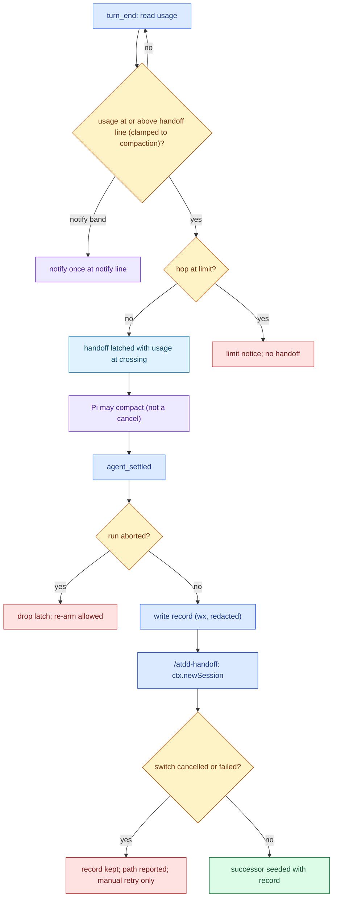

# PLT-102 — automatic context handoff at 85% usage (design note)

Status: built on this branch; draft PR #22. Revised after the Coach's independent review (RETURN) to fix
the compaction race and secret leakage, and to add the `shared.handoff.*` rules.
Linear: [PLT-102](https://linear.app/forge100/issue/PLT-102/add-automatic-context-handoff-at-85percent-usage).

## 1. Acceptance (from Linear, the only source: no plan acceptance record exists for PLT-102)

| # | Given | When | Then | Proof |
|---|---|---|---|---|
| AC1 | usage < 80% | a turn ends | nothing happens | unit: `decideContextAction` |
| AC2 | usage ≥ 80% | a turn ends | user notified once | unit |
| AC3 | usage ≥ 85%, agent idle | a turn ends | record written, new session seeded | adapter test; real Pi RPC run |
| AC4 | agent mid-run / compacting | usage crosses 85% | switch waits for `agent_settled`; compaction does not cancel it | adapter test (latch); real Pi RPC run with `compaction_start/end` |
| AC5 | work done | — | tests first, `npm run check` green, draft PR, no merge | CI on PR #22 |

Out of scope: transport of attention items (PLT-101).

## 2. Design

Lives in the existing extension (`extensions/atdd.ts` → `src/pi-activation.ts`). Pure decisions, redaction and record text are in `src/context-handoff.ts` (no Pi imports).

### 2.1 Hooks

| Hook | Does | Why here |
|---|---|---|
| `turn_end` | Reads `ctx.getContextUsage()`. `decideContextAction` → notify once, or **latch** a handoff request with the usage that crossed the threshold. Clamps the threshold to Pi's compaction line. Bounds by hop. | Usage is current per turn. |
| `agent_settled` | If a request is latched: **aborted → drop** (and re-arm allowed); otherwise write the record and request `/atdd-handoff`. Usage is **not re-read**. | Documented idle boundary. Pi compacts *before* this point, so the request must not depend on post-compaction usage. |
| `/atdd-handoff` command | `ctx.newSession({parentSession, setup, withSession})`. `setup` seeds the record as the first user message; `withSession` sends the kickoff through the replacement ctx only. The record stays pending until the switch succeeds. | `ctx.newSession` is command-only (Pi docs). |

### 2.2 Thresholds and compaction

- Defaults 80 (notify) / 85 (handoff), env `PI_ATDD_HANDOFF_NOTIFY_AT` / `PI_ATDD_HANDOFF_AT`; invalid values throw.
- Pi auto-compacts when `contextTokens > window − reserveTokens`. The effective handoff threshold is capped at that line (`clampToCompaction`), so on small windows the handoff fires before compaction; otherwise it would never fire.
- The reserve is resolved as Pi does, per field: the active model's `compaction.modelOverrides["provider/id"].reserveTokens`, then the global `compaction.reserveTokens`, then the default 16,384 (`resolveCompactionReserve`, using `ctx.model`). Invalid values fall back to the default; Pi itself rejects them when it compacts.
- Each action fires at most once per session.

### 2.3 Hop bound

- The record carries `Hop: N`. A successor reads it back from the session branch (`parseHop`); plain text is hop 0.
- A session at `PI_ATDD_HANDOFF_MAX_HOPS` (default 5, 1–50) reports a chain-limit notice and does not hand off again.

### 2.4 Record (`shared.handoff.record-contents`)

Written to `.atdd-pi/handoffs/<timestamp>.md` (gitignored, `wx`), bounded to 6,000 characters.

- **Included:** issue id (or `unknown`), workspace, revision (or `UNKNOWN`), usage at the crossing (the *latched* value), hop, the task text (secret-shaped values redacted, clipped at 1,200), next, open items (`UNKNOWN`), grant (by reference), how to resume, record path.
- **Excluded:** the predecessor's assistant output. It is recorded as `not recorded`. (Unverified, and it carried the secret in the first review.)
- **Redaction** (task text only, **best-effort and list-based, not general secret safety**): assignments whose label is one of `password`, `passwd`, `pwd`, `passphrase`, `secret`, `token`, `credential(s)`, `auth`, `authorization`, `api_key`, `apikey`, `access_key`, `private key`, `client_secret` (`:` or `=`); `Authorization Basic …`; `Bearer …`; `sk-…`/`pk-…`/`ghp_…`/`xox…`/`AKIA…` provider token shapes; and mixed letter+digit runs of 32+ characters. Over-redaction (e.g. a SHA in the task) is accepted. A secret with a label or shape not on this list passes unchanged. The workspace and record paths are not redacted.

## 3. Sequence

## 4. Adversarial review (worker, after the Coach's RETURN)

| Element | Weakest point | Response |
|---|---|---|
| Settle re-read (**P1, fixed**) | Pi compacts between `turn_end` and `agent_settled`; the re-read lower usage dropped the handoff (observed in real Pi RPC by the Coach). | Latch at `turn_end`; settle drops only on abort. Real run: compaction between the two; handoff still written. |
| Record secrets (**P1, fixed**) | The prompt and the assistant's output were copied verbatim; a seeded password reached disk. | Redact task text; omit assistant output. Real run: no `TOPSECRET`, no assistant output in any record. |
| Chain loop (found in real run, fixed) | A successor seeded above the threshold handed off again: about 20 sessions. | Hop in record; limit at `PI_ATDD_HANDOFF_MAX_HOPS`. Real run stops at 2 with a limit notice. |
| Compaction preempts 85% on small windows | Pi compacts at `window − reserve`, which can be below 85%. | Threshold clamped to the compaction line, using the active model's override when one exists (unit-tested and real Pi RPC, section 5). |
| `newSession` cancelled or throws | Record exists, no successor. A retry loop would be bad. | Record kept, path reported, no automatic retry; unit-tested for cancel and throw. |
| Over-redaction | A SHA or long slug in the task is redacted. | Accepted. The redaction is one-way and only affects the task text. |
| Under-redaction | A secret with a label or shape not in the list passes. | Known gap: the redaction is best-effort and list-based. It is not general secret safety; keeping secrets out of prompts is the real control. |
| Command visible in transcript | `/atdd-handoff` appears as a user message. | Accepted; required by the command-only `newSession` API. |
| Predecessor's session file | Pi's own session file keeps the original prompt, including any secret typed into it. | Not changed by this PR. The record no longer adds to it. |
| Stale ctx/sessionManager | Captured objects are invalid after replacement. | Only the `withSession` ctx; pending data is plain text. |
| Hop from chat text | A user could type `Hop: 9`. | Hop is read only from a message that carries the record header. |

## 5. Evidence

- **Unit/adapter tests:** `npm run check` green: 187 tests, including `tests/context-handoff*.test.ts` (latch, redaction, hop bound, per-model reserve, label coverage).
- **Real Pi RPC, compaction latch** (temp `PI_CODING_AGENT_DIR`, faux 1k window, `reserveTokens` 400, `keepRecentTokens` 50, `PI_ATDD_HANDOFF_MAX_HOPS` 2). Timeline: `turn_end → agent_end → compaction_start → compaction_end → agent_settled`, then the record is written with the latched 237.9% usage. The Coach's earlier run showed the same order dropping the handoff before this fix.
- **Real Pi RPC, redaction**: seeded `password=TOPSECRET` and `Authorization Bearer abc.def-123` in the prompt. First record shows `password=[REDACTED]` and `Bearer [REDACTED]`; neither secret nor the faux assistant output appears in any record.
- **Real Pi RPC, chain bound**: two handoff records, then `ATDD handoff chain limit (2 hops) reached`.
- **Real Pi RPC, per-model reserve (re-review P1)**: 20k faux model; global `compaction.reserveTokens` 100, model override `plt102-faux/small` `reserveTokens` 8000, so Pi compacts at 60%. Turns measured from the session file: 27.9% then 64.6%. Override run: 1 handoff record, 2 sessions (`compaction_start/end` after turn 2, successor takes turn 3). Control with the global reserve only, same prompts: 0 handoff records, 1 session, same usage (the value the old global-only code read). The window is 20k rather than 1k because Pi's own system prompt is about 2.3k tokens; a 1k window is already past any line.
- **Real Pi RPC, redaction labels (re-review P2)**: unit tests cover `credential=`, `auth=`, `passphrase=`, `secret:`, `token=`, `apikey=`, `api_key=`, `private key:`, `private_key=`, `authorization=` and `Authorization Basic`, plus ordinary words that contain a label (`author:`, `oauth`, `credentials review`) left unchanged.

Not run: a counterfactual on the pre-fix code in this session (the Coach's run is the evidence there).

## 6. Enforced vs text-only

| Aspect | Status | Why |
|---|---|---|
| Threshold decisions, notify/handoff once, clamp | **Enforced** | Pure functions, unit-tested. |
| Latch at crossing; drop only on abort | **Enforced** | Adapter test and real Pi run. |
| Hop bound | **Enforced** | Real Pi run; adapter test. |
| Secret redaction of task text | **Best-effort only** | Pattern list over listed labels and token shapes. Not general secret safety; an unlisted label or shape passes. |
| Record excludes assistant output | **Enforced** | Field not written. |
| Successor's correct resumption | **Text-only** | Depends on the successor; kickoff asks it to re-verify. |
| Grant | **Text-only** | Named by reference to the brief. |
| ATDD applicability | **Not claimed** | Stays UNKNOWN; CI and the independent reviewer are authoritative. |

## 7. Convention and selector

- `shared.handoff.record-contents` and `shared.handoff.bounded-chain` in `catalog/pi-atdd/conventions/shared/handoff/`, with `catalog/pi-atdd/relationships.yaml` nodes and one `requires` edge (bounded-chain → record-contents, mandatory).
- Selector `context-handoff` in `selectors/default.yaml`. The `pi-atdd` source digest is pinned in `src/catalog.ts` and `vendor/catalog.lock.json`.

## 8. Open questions for the owner

1. (Resolved in the re-review: the active model's `compaction.modelOverrides` reserve is read first. See section 5.)
2. Thresholds as environment variables or a settings key?
3. Should a successful handoff end the old session, or leave it? Current: Pi replaces it.
4. Is a plan acceptance record for PLT-102 needed? Current: acceptance is the Linear AC list only.

## 9. Overlaps (reported, not resolved)

- PLT-101 (attention strip): out of scope.
- PLT-96/97/100 (catalog counts, selectors): this PR adds a selector and two rules to the `pi-atdd` source. Any count assertions elsewhere were not changed.
- PLT-98 (`smoke:catalog`): not touched.
