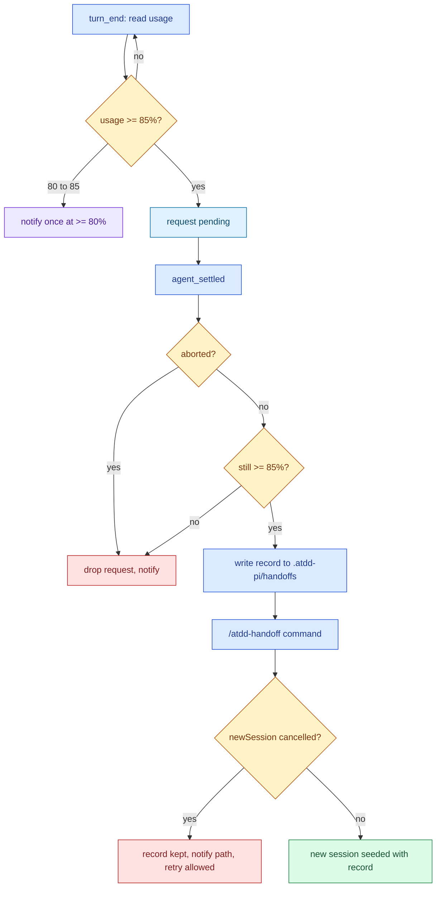
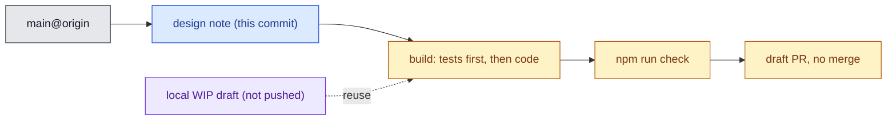

# PLT-102 — automatic context handoff at 85% usage (design note)

Status: design note, reviewed adversarially by the worker before build. No code in this commit.
Linear: [PLT-102](https://linear.app/forge100/issue/PLT-102/add-automatic-context-handoff-at-85percent-usage) · Coach brief: context-handoff, 2026-11-19.

## 1. Goal and acceptance

Acceptance criteria from Linear, restated as checks the build must meet:

| # | Given | When | Then |
|---|---|---|---|
| AC1 | usage < 80% | a turn ends | nothing happens |
| AC2 | usage ≥ 80% | a turn ends | user is notified exactly once |
| AC3 | usage ≥ 85%, agent idle | a turn ends | handoff record is written and a new session is opened seeded with it |
| AC4 | agent mid-run | usage crosses 85% | the switch waits until the run settles |
| AC5 | work done | — | tests first, `npm run check` green, PR is draft, no merge |

Out of scope: transport of attention items (PLT-101).

## 2. Design

Everything lives in the existing extension (`extensions/atdd.ts` → `src/pi-activation.ts`). One new pure module, `src/context-handoff.ts`, holds the decision and record text with no Pi imports, so it is unit-testable.

### 2.1 Hooks

| Hook | Reads | Does | Why this hook |
|---|---|---|---|
| `turn_end` | `ctx.getContextUsage()`, `event.message` | Decides `none` / `notify` / `handoff` via `decideContextAction`. Sets a pending request for `handoff`. Stores last assistant text. | Fires after each turn is persisted, so usage is current. It is per turn, so a crossing mid-run is seen. |
| `agent_settled` | `event.aborted`, `ctx.getContextUsage()` | If a request is pending: aborted → drop. Usage re-checked → below 85% → drop. Otherwise write the record and call `pi.sendUserMessage("/atdd-handoff", {expandPromptTemplates: true})`. | Documented idle boundary. `ctx.newSession` is only available to commands, so the switch must be requested through a command. |
| `/atdd-handoff` command | pending record | `ctx.newSession({parentSession, setup, withSession})`. `setup` appends the record as the first user message. `withSession` sends the kickoff using the replacement ctx only. | Only command handlers may call `newSession`. The pending record is cleared only on success. |

### 2.2 Thresholds

- Defaults: notify at 80, handoff at 85 (percent of the model's context window).
- Configured by environment variables `PI_ATDD_HANDOFF_NOTIFY_AT` and `PI_ATDD_HANDOFF_AT`. There is no extension settings schema to extend, and a new one would be more surface than this task needs.
- Invalid values throw. They do not silently fall back. Requirement: `0 < notify ≤ handoff ≤ 100`.
- Each action fires at most once per session. `null` or non-finite usage never triggers anything.

### 2.3 Handoff record

Written to `.atdd-pi/handoffs/<timestamp>.md` inside the workspace (already gitignored). Shape follows the `shared.handoff.*` convention: issue id, workspace, revision, usage, task, done (last state, marked unverified), next, open items, grant, how to resume, record path. Bounded to 6,000 characters.

Fields the extension cannot know are written as `UNKNOWN`. Examples: open items, and the revision unless the repository observer supplies it. The record never guesses.

### 2.4 What the new session receives

1. One user-role message: the full record. It states that the done section is the predecessor's own unverified output.
2. A kickoff sent through the replacement ctx: "Continue from the ATDD context handoff above. Re-verify any claimed completion before relying on it."
3. Nothing else is carried over. Repository state is the source of truth; the session does not inherit approvals, grants or memory.

## 3. Sequence

## 4. Adversarial review

Each hook and threshold, its weakest point, and what the design does about it.

| Element | Weakest point | Response in this design |
|---|---|---|
| `turn_end` usage read | `getContextUsage()` is an estimate for trailing messages; `percent` can be `null`. | `null` never triggers. Estimate error is accepted; the 80/85 gap absorbs it. |
| Single-turn jump | One huge turn can go from below 85% to past the window. There is no turn boundary to act on. | Accepted and documented. Pi's own overflow recovery handles that case. |
| Pi auto-compaction preempting | Pi compacts when `contextTokens > window − reserveTokens` (default 16,384). That is about 92% for a 200k window, so 85% fires first. For windows ≤ ~109k tokens, compaction starts *before* 85% and the handoff never fires. | Not fixed in code. Named as an open question (§6). Default models are unaffected. |
| `notify` once | Notifying and then crossing 85% in the same run. | Notify and handoff states are separate; a jump straight to 85% skips notify and hands off (tested). |
| Mid-run wait | Long runs or queued messages delay `agent_settled`; usage can grow or fall meanwhile. | Waiting is the spec (AC4). At settle the usage is re-read, so a compaction that freed room cancels the handoff. |
| Abort (Escape) | Switching sessions under a user who just pressed Escape is hostile. | Aborted settles drop the request and notify. Not silently retried. |
| Re-check at settle | Could drop a handoff that was correctly armed. | Accepted: if usage fell below 85% the session no longer needs it. Tested. |
| `ctx.newSession` cancelled by another extension | Record exists on disk but no new session. A naive retry loops. | Record kept, path notified, pending record kept so a manual `/atdd-handoff` can retry. No automatic retry. |
| Command surfaced as chat | The `/atdd-handoff` user message is visible in the transcript. | Accepted. Required by the command-only `newSession` API. |
| Stale predecessor objects | Captured `ctx`/`sessionManager` are invalid after replacement. | Only the `withSession` ctx and plain strings are used. Pending data is plain text. |
| Injection via record | `lastState` is model output, sent back as a user-role message. | Framed as unverified predecessor output; the kickoff tells the successor to re-verify. Not a trust boundary. |
| Privacy | The record contains task text and last state, possibly private. | Stored only in the gitignored workspace folder. Sent to the same model the session already uses. No new remote destination. |
| Record write failure | Disk full, permissions. | Writes with `wx` (no overwrite). Failure notifies and does not arm the switch. |
| Chained handoffs | A successor can itself reach 85%. | Ephemeral state resets on session start, so each session can hand off once. A loop is possible across sessions, and is accepted: each hop needs real usage. |
| Revision | The observer may not supply a revision. | `UNKNOWN` when absent. Not guessed from chat text. |
| Thresholds | Bad values silently change behaviour. | Invalid values throw; tested. |

### Changes from the brief after review

1. Re-check usage at `agent_settled`, not only at `turn_end` (compaction can free room mid-run).
2. Aborted settles drop the request instead of switching.
3. Cancelled `newSession` keeps the pending record for manual retry, and does not retry automatically.
4. The decision and settle logic are pure functions, so each failure case is a unit test.

## 5. Enforced vs text-only

| Aspect | Status | Why |
|---|---|---|
| Threshold decision, once-only notify and handoff | **Enforced** (code, unit tests) | Pure function, tested. |
| Wait for settle; abort drops; re-check drops | **Enforced** (code, adapter test) | Driven by Pi events. |
| Record written before switch; `wx` no-overwrite | **Enforced** | File write precedes command request. |
| Session switch and seeding | **Enforced** when Pi accepts it | `newSession` may be cancelled; then the record is kept and reported. |
| Content of done, next and open items | **Text-only** | Copied from model output or `UNKNOWN`. Not verified. |
| Successor actually resumes correctly | **Text-only** | Depends on the successor's reasoning; the kickoff only asks it to re-verify. |
| Grant carried forward | **Text-only** | The record names the grant only by reference to the brief. The successor must read the brief. |
| ATDD obligations | **Not claimed** | The record states unresolved applicability stays UNKNOWN. CI remains authoritative. |

## 6. Open questions for the owner

1. Compaction preemption: should the extension warn when Pi's compaction threshold for the active model is ≤ 85%? That needs reading `compaction.reserveTokens`. This build does not do it.
2. Should a successful handoff also stop the old session's further work, or leave it? Current design: Pi replaces the session, so the old one ends.
3. Environment variables vs a settings key for thresholds. Current choice: environment variables.

## 7. Verification plan (build step, tests first)

- `tests/context-handoff.test.ts`: thresholds (defaults, valid, invalid); decision (below 80, notify once, 85 handoff once, jump to 85, null/NaN); settle decision (aborted drops, re-check drops, still ≥85 proceeds); record (bounded, UNKNOWN fields, clipped).
- Adapter test with a fake `pi` and `ctx`: `turn_end` at 86% → settle writes a record → command requested with `expandPromptTemplates`; second settle does nothing; command seeds the new session and kicks off; pending record consumed once; cancelled `newSession` keeps the record and reports its path.
- `npm run check` green. Temporary `PI_CODING_AGENT_DIR` only. No edits to `~/.pi` or `installed`.

## 8. Overlaps (report only)

- PLT-101 (attention strip): explicitly out of scope.
- PLT-96, PLT-97, PLT-100, PLT-98 (catalog counts, selectors, smoke:catalog): not touched. `smoke:catalog` is not fixed here.

## 9. Mermaid — state of the workspace

