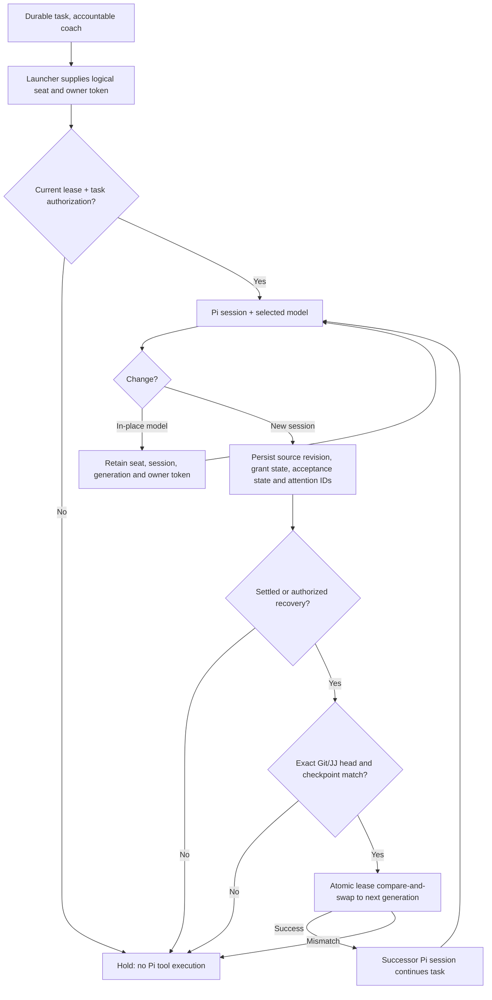

# PLT-117 — Deterministic task-seat and session lifecycle

Status: implementation in [PLT-117](https://linear.app/forge100/issue/PLT-117).
Delivery branch: `feature/plt-117-make-atdd-execution-resumable-across-seats`.
This is an adapter contract, **not** a second task/seat registry or evidence of completed acceptance.

## Visual summary

## Source-grounded obligations

| Existing source | Obligation preserved | Deterministic observation |
| --- | --- | --- |
| `coach.naming.instance-label` (PLT-100) | Coach identity remains project/repository scoped | `coachAddress` never changes inside a handoff |
| `coach.role.orchestrate-not-build` and `coach.policy.action-tiers` (PLT-100) | A model/seat change is not new authority to merge/build/spend | Checkpoint records grant as `verified` or `unknown`; unknown is not a grant |
| `coach.collaboration.accountable-delegation` (ATDD Flow) | Accountability follows coordinator, not transient worker | Task and coach IDs remain immutable across attempts |
| `coach.workflow.lifecycle` (ATDD Flow) | Work and reviews are phase/accountability driven | Model/session switches do not assert acceptance or task completion |
| `shared.handoff.record-contents`, `shared.handoff.bounded-chain` (PLT-102) | Continuity without changing the source obligation | Source/head, task, grant, attention and bounded hop are checked |
| `PLT-101` attention event contract | Open decisions survive agent replacement | Signed attention IDs must be verifiable before a scoped handoff |

The table maps **existing** conventions. It does not add graph edges, alter upstream YAML,
or claim that untested behaviors have been proven.

## Stable identities and transitions

- `projectId`: local governed project key; an optional Linear reference is not authority.
- `taskId`: durable work ID, independent of execution attempts.
- `coachAddress`: durable accountable recipient; never a Pi session ID or free-text label.
- `seatAddress`: logical execution seat, not the running process.
- `executionId`, `sessionId`, `modelId`: replaceable runtime observations.
- `generation`, `ownerToken`: fencing tuple for the current seat holder.

**Given** a valid task/coach/seat binding and exact owner token, **when** Pi changes
model within the same session, **then** the lease keeps the same session, execution
and generation and records the new model.

**Given** a verified checkpoint and a settled source session, **when** Pi opens a
new session for the same task/coach/seat, **then** a compare-and-swap increments
the generation, rotates the owner token, and fences the previous Pi session
before the successor receives a kickoff.

**Given** a conflicting owner, missing checkpoint, unreadable attention store,
unverified repository head or changed task, **when** replacement is attempted,
**then** no next owner is recorded and the task remains pending.

**Given** an interrupted session, **when** a trusted runtime controller authorizes
recovery using the last verified checkpoint, **then** the same generation-fenced
transition applies. A model's declaration of completion is never recovery authority.

## Authority adapters

- **Standalone Pi:** explicit `PI_ATDD_EXECUTION_MODE=standalone` plus a complete
  launcher-provided `PI_ATDD_EXECUTION_*` binding. Local lease receipts live under
  `PI_CODING_AGENT_DIR/execution/seats/`; bootstrapping generation 1 is explicit.
  A checked model switch updates the receipt; a verified session handoff performs
  an atomic local lease update.
- **ATDD Flow:** `PI_ATDD_EXECUTION_MODE=external`, `ATDD_WORKFLOW_ROOT`, and
  the launcher binding. The adapter reads Flow's task YAML, seat YAML and token-fenced
  `.atdd-flow/pi-runtime/*.yaml` records. It cannot mint or rebind a Flow seat:
  Flow's own authoritative controller must perform the replacement.
- **Unconfigured sessions:** no execution-seat hooks are registered; existing Pi
  users are unaffected.

Source-of-truth boundaries: Linear for human-visible issue state when Linear governs
that work; Flow Desk when Flow governs execution; Pi for runtime/context operations;
Git/JJ for exact code history. This adapter does not duplicate these registries.

## Crash and concurrency discipline

Atomic write plus a directory lock protects local seat generation changes. A lock
from a provably dead local PID can be reclaimed after a grace period under a second
recovery mutex. An unknown or live owner is never stolen; manual inspection is needed
for a crash before lock metadata was written. The source revision is verified again
at the successor boundary. Same-user processes remain outside a hostile-process
security guarantee; the launcher's OS identity and Flow controller remain trusted.

## Verification and limits

The pure contract and file-backed adapter are covered by `tests/execution-lifecycle.test.ts`,
`tests/execution-seat.test.ts` and `tests/durable-lock.test.ts`. Pi hooks block
tool calls from stale sessions. CI runs the full repository check and existing
Pi RPC/package/catalog smoke; these are not proof of real provider rate-limit
detection or a cross-host automatic model swap.

A live Flow-controlled model/session swap continues to be performed by Flow's
runtime controller. The Pi adapter **refuses** to self-assign an external seat.
Model switching via Pi's native model control is supported inside the current
session. Restarting a fresh session is supported on the standalone adapter;
the Flow-mediated equivalent requires Flow's own verified rebinding.

Outstanding design limit: a successful checkpoint carries `unknown` acceptance
and grant states unless separately verified; that never authorizes privileged action.
