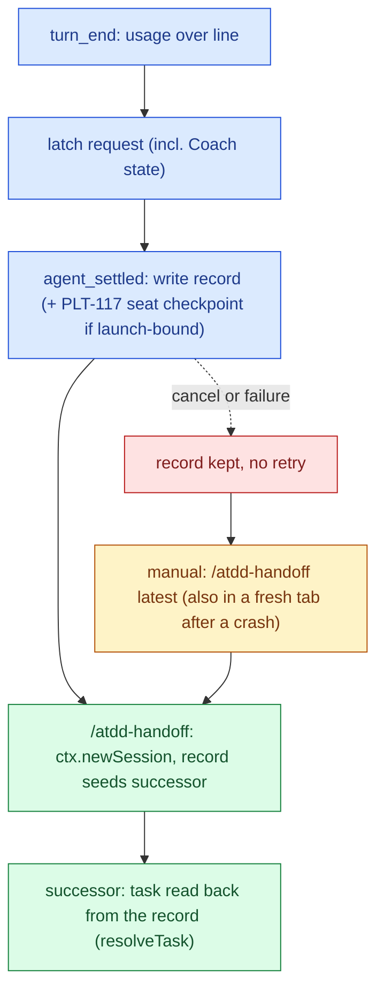

# PLT-122 — automatic context renewal for Coach and worker sessions (design note + convention proposal)

Status: draft PR. Builds on PLT-102 (handoff at 85%) and PLT-117 (seat checkpoint). No second resume mechanism.

## Verified in a real Pi session (before building)

| Question | Result |
|---|---|
| Model tier kept in the successor | Yes (`newSession` stays in the same process and model) |
| `PI_ATDD_ATTENTION_ROLE/IDENTITY/PROFILE` kept | Yes (process environment is unchanged; the strip re-runs on `session_start`; spool state re-ingested) |
| Extension state | **Reset**: Pi re-instantiates the extension per session. Hop and task must come from the branch. |
| Gap found | After hop 1 the task became the kickoff text; the original task was lost. |

## Changes

| Acceptance | Change | Proof |
|---|---|---|
| A01/A02 | none needed for env/model; seat checkpoint path covered | `tests/context-renewal.test.ts`, `npm run smoke:renewal` |
| A03 | none (thresholds already env-driven, default 80/85) | unit |
| A04 | `resolveTask`: the record's task wins over the kickoff; `Coach state:` section for role `coach` | unit + adapter + real session |
| A05 | `/atdd-handoff latest` or `<file>` seeds from a kept record, only files directly in `.atdd-pi/handoffs/` | adapter + real fresh process |
| A06 | `npm run check`, all smokes | CI |

Coach state fields: role (identity, profile), issues and PRs (read from the task text), attention items (the strip's
last rendered open items), workers / owner decisions / next steps. Anything not known is `UNKNOWN`; fields are redacted and
bounded; no assistant output is copied.

## Convention proposal (owner approves; the active rule is NOT edited here)

Rule: `shared.handoff.record-contents`. Proposed addition to `normative_text`:

> When the handing-off session is a Coach, the record also carries a `Coach state` section with: role, issues,
> workers, pull requests, attention items, owner decisions and next steps. A field that cannot be established is
> written `UNKNOWN`. The section is redacted and bounded like the task text and never contains the predecessor's
> assistant output. The original task text is carried unchanged through every hop of a chain.

Until the owner approves, the code writes the section but the rule text does not require it. Goes through `shared.convention.propose`.

## Not exercised

- A real Coach run against a live attention spool with several open items (the strip's list is covered by the unit path only).
- A real Pi run with a launch-bound PLT-117 seat (covered by the adapter test with a real git repo and lease files, not the Pi runtime).
- Real compaction interplay in this PR (unchanged from PLT-102 evidence).
- Workers, owner decisions and next steps are never filled automatically: the Coach has no authoritative source for them yet.
