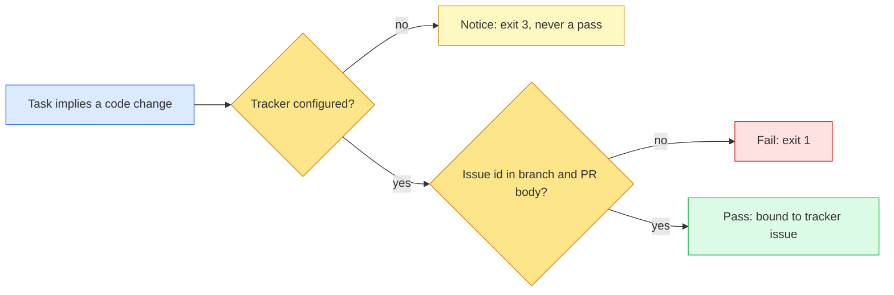

# PLT-96 — code-changing work is bound to an issue in the configured tracker

Status: feature branch, draft PR, not merged. Owner decision 2026-11-19.



## Problem

`planner.plan.confirm-binds-an-issue` (ATDD-Bun, vendored unchanged) requires a **local** ATDD issue record per repository modification. The external tracker is an optional downstream sync, so code, CI and cloud-config changes could land with no tracker issue the owner can see.

## Rule set

Package-authored under `catalog/pi-atdd/conventions/<profile>/<area>/` (PLT-87 naming, lint N-001 applies).

| Rule id | Profile | Obligation | Selected by | Enforcement |
|---|---|---|---|---|
| `shared.tracker.issue-mandatory` | shared | A code change (repo file, CI, deploy/infra, cloud build config) is bound to a tracker issue before its first change; no issue → ask, create only with approval; id in branch and PR body; status kept current | task-start, code-change terms | **Validator** `atdd tracker check` (branch + PR body + changed paths); CI must run it; status = text |
| `shared.tracker.unconfigured-notice` | shared | No tracker configured → say so explicitly; never pass silently, never invent a tracker or id | task-start, `tracker` / `issue tracker` terms | **Validator** notice (exit 3) |
| `coder.tracker.issue-in-branch-and-pr` | coder | Branch name and PR body carry the id; status In Progress → Done, blocked = comment | task-start, `pull request` / `branch` / `push` terms | Validator (branch and body); status = text |
| `planner.tracker.issue-before-ratify` | planner | Ratifying a plan binds it to the local issue **and** to a tracker issue | task-start, `ratify` / `decomposition` / `confirm` terms | Text (validator does not read plans) |

Code-changing is **any repository file** (documentation included), classified as `repo-file`, `ci`, `deploy-infra` or `cloud-build` for reporting. Read-only work needs no issue.

## Tracker by configuration

The tracker is named in `atdd-pi.yaml`, never in code:

```yaml
schema: pi-atdd/config/v2
tracker:
  kind: <tracker name>
  issuePattern: '<regular expression matching an issue id>'
```

Absent or empty `tracker:` means **unconfigured**: the check returns `notice`, not `pass`. Invalid `kind` or pattern is a configuration error. `tests/tracker-issue.test.ts` (A4) fails if the module names a tracker product.

## Relationship to `confirm-binds-an-issue`

**Extends, does not contradict.** The local binding stays the iron rule (issue, branch, worktree). `planner.tracker.issue-before-ratify` adds the tracker link and `requires` the local rule (`catalog/pi-atdd/relationships.yaml`). The vendored YAML is byte-identical; the bundled Bun and Flow digests are unchanged.

## Selection and the page-budget decision

- Task start: broad code-change wording selects the obligation and its notice together (review P1). Non-code wording still reports an applicability gap.
- Edit/create: a write to any repository file is code-changing by definition, so `tracker-code-write` selects the obligation and notice on every write (`always`, operations `edit`/`create`). This masks the coder-convention gap for writes, since a tracker rule now matches them.
- **Open conflict (decision needed):** pre-edit pages have a 12,000-character budget and PLT-79 (`tests/shell-delivery.test.ts`, t10) requires a blocked write to pass on one retry. With the edit/create obligation, t10's first page holds the write's rules and the `tester.test.carries-urn-identity` rule no longer fits, so the retry is blocked again. Dropping the notice from edit/create does not fix it. Options: (a) raise the write budget to 16,000 (checked in a copy: all of `shell-delivery` passes); (b) drop edit/create selection and keep task-start only.
- Change-time enforcement is the validator (`atdd tracker check`, which now fails when `--changed` is omitted) and CI.

## Enforced vs text-only

| Obligation | Enforced | How |
|---|---|---|
| Issue id in branch name and PR body; change set with no id fails | Yes (validator, exit 1) | `atdd tracker check` |
| No tracker configured is visible, not a pass | Yes (exit 3 + message) | `atdd tracker check` |
| Rules selected for coder, planner and coach task starts | Yes (tests) | `tests/tracker-issue.test.ts` A1 |
| Issue status kept current (In Progress / Done) | **No** | Text obligation; no tracker read |
| Issue created or asked for before the first change | **No** | Text obligation |
| Planner links plan to tracker issue | **No** | Text obligation |
| Cloud build settings changed in a console (outside the repo) | **No** | No file to observe |
| Repository-wide CI running the validator | **No** | Not added in this PR; needs a workflow change (owner decision) |

## Verification

- `npm run check`: typecheck and the full suite pass (12 new in `tests/tracker-issue.test.ts`). CI also runs `smoke:catalog`, `smoke:install` and `smoke:pi`; all three pass locally against the pinned upstream checkouts.
- Seeded case: a `src/` change with no issue id in branch or body fails (`A2`); the CLI exits 1.
- Pins follow PLT-98: `vendor/catalog.lock.json` holds the `pi-atdd` digest (`00a1de5f…`, recomputed after rebasing onto PLT-100), and the tests compare ids, kinds, revisions and digests against that file rather than against rule or edge counts. PLT-100's coach rules and edges are kept; `relationships.yaml` now carries both families in one registry.
- The N-004 rename-parity probe now allows exactly one PLT-96 addition by scenario: "set up a jujutsu worktree for the integration branch" activates the tracker rules because the `branch` term matches. Any other new tracker activation fails the test.

## Open questions for the owner

1. Should a CI workflow run `atdd tracker check` on every PR? (Not added here.)
2. Which tracker `kind` and `issuePattern` should this workspace configure? (Not set here: `atdd-pi.yaml` is not changed.)
3. Is docs-only work (`README.md`, `docs/`) also code-changing? The rule says yes, as written. Confirm.
4. Should `tracker check` also read the PR body from the PR itself (GitHub API) instead of a file?

## Pre-existing observation (not changed here)

`package.json` `files` lists `extensions`, `src`, `vendor`, `selectors`, `README.md` but not `catalog/` or `conventions/`. Git-based install (the README's documented path) carries them. An npm tarball would lack the pinned `pi-atdd` source and fail to load. Fix in a separate change.
