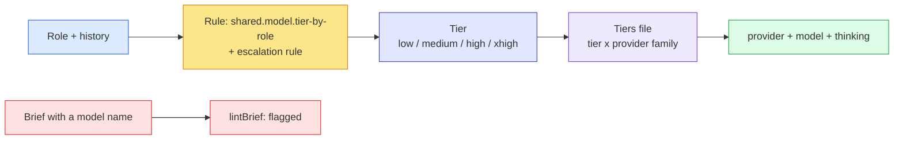

# PLT-97 — model tiers by role and task (design note)

**Status:** draft PR, not merged. Owner review and an independent audit of the new rules are required before merge (see [open questions](#open-questions)).
**Spec:** [PLT-97](https://linear.app/forge100/issue/PLT-97). Related: PLT-87 (profile-first ids), PLT-96 (tracker rule), PLT-84 (rule rewrites).

## Problem and target

Tiers (`low`, `medium`, `high`, `xhigh`) exist only as an owner rule in `~/AGENTS.md`, a tiers file and a resolver outside this repository. Agents that launch sub-agents or workers pick models ad hoc and drift to the most expensive one.

Target: model choice is a **convention** (profile-first rule ids, statements, selector, tests) and a **craft** (a deterministic resolver and a helper an agent calls before launching another agent). Briefs, rules and repository files name tiers only. The configured tiers file is the single place where a tier becomes a provider, model and thinking level.

## Rules (catalog/pi-atdd/conventions/shared/model/)

| Rule id | Obligation | Disposition |
|---|---|---|
| `shared.model.tier-by-role` | planners, testers, coders and bounded-task operators → `low`; coordinators and coaches → `medium`; `high`/`xhigh` only on an explicit owner request for a named task; the PR reviewer keeps its configured model | strict |
| `shared.model.names-only-tiers` | briefs, rules, configs and repository files name tiers, never a model name, model id or `--model` flag | strict |
| `shared.model.escalate-after-two-failures` | one tier up only after two failures, both reported with evidence; never silent; `high`/`xhigh` still need the owner's request | strict |
| `shared.model.subscription-providers` | subscription families only; `anthropic` and `openai` (per-token) never used unless the owner names them; family switch is the owner's call; no silent fallback | strict |

**Why `shared.*`:** the PLT-87 path delivers `shared.*` to every profile (`rulesForProfile`). The test `PLT-97-ACC-1` asserts all four reach `planner`, `tester`, `coder`, `reviewer`, `coach` and `shared`, so every profile that launches agents receives them.

**Selector:** `model-tier-choice` in `selectors/default.yaml` (operations `task`, `edit`, `create`). Activates on launch wording (`sub-agent`, `launch agent`, `spawn agent`, `agent brief`, `model tier`, …) or on `**/briefs/**`, `**/model-tier*.ts`, `**/model-tiers*.yaml`. Unrelated wording does not activate it (tested).

**Patterns copied:** rule YAML with `schema_version`, `rule_id`, `kind: policy`, `statement`, `terms`, `content` (`summary`, `normative_text`, `fix_hint`), `exceptions`, `metadata` and `implementation: none` from `shared.convention.propose`; the directory layout `conventions/<profile>/<area>/<id>.convention.yaml` from PLT-87 (`namingViolations`); the `pi-atdd` source entry and pinned digest from `bundledSources()`; the resolver style (Bun-free, `yaml` parser, fail-closed errors) from `src/mode.ts` and the owner's `model-tier`.

## Craft

| Piece | File | Role |
|---|---|---|
| Tiers reader | `src/model-tier.ts` `parseTiers`, `loadTiers` | reads the tiers file from `MODEL_TIERS_FILE`, else `~/.config/model-tiers.yaml`; embeds no model names |
| Resolver | `resolveTier` | tier → `{provider, model, thinking}` |
| Role chooser | `chooseTier` | role default, escalation, owner request |
| Brief lint | `lintBrief` | flags `--model`/`--provider` flags, model-id shapes and configured model ids |
| Agent helper | `src/model-tier-cli.ts` (`npm run model-tier -- …`) | `<tier>`, `role <role>`, `table`, `lint-brief <file>…` (exit 1 on a hard-coded model) |

**Family precedence** (same as the owner's resolver): `--via` → `MODEL_TIERS_ACTIVE` (one run) → tier's own `active` → file `active`.

**Fail closed on:** unknown tier; tier absent from the file; unknown provider family (`--via`, env, `active`, or a family key in the file); family without a model for that tier; `anthropic` or `openai` as a provider; malformed YAML; missing file; missing `providers`/`active`; unknown role (including `reviewer`); escalation without a report; escalation to `high`/`xhigh` without a named owner request; an owner request for a tier other than `high`/`xhigh`.

**Escalation:** `floor(failures / 2)` steps above the role tier, each requiring `reported: true`.

## Replace or wrap the existing `~/.local/bin/model-tier`

**Proposal: wrap, do not replace (not decided; owner's call).** The repository resolver reads the same tiers file, uses the same precedence and rejects the same providers, so the two cannot diverge on the owner's file. `table` on the owner's file reproduces the global command's output. The global command stays as it is; no file under `~/.config/` or the installed worktree was changed. A later step could point the global command at this CLI once the owner has reviewed it.

## Enforced versus text-only

| Item | Enforced by | Notes |
|---|---|---|
| Resolver tier → model, precedence, fail-closed | unit tests (`tests/model-tier.test.ts`) | deterministic, offline |
| Role default, escalation, owner-request gate | unit tests | the helper must be called to get the gate; nothing forces a launcher to call it |
| Brief with a hard-coded model is flagged | `lintBrief` / `model-tier-cli lint-brief` | not wired into CI or into a Pi tool yet |
| No model names in repository convention files | test `PLT-97-ACC-4` (scans `catalog`, `conventions`, `vendor`) | a scan, not a detector |
| Rule text delivered to every profile and selected for launch wording | tests `PLT-97-ACC-1` | delivery is not compliance |
| Agent actually chooses the tier, reports failures, avoids per-token providers | **text-only** | review and the owner's reports are the only check |
| `high`/`xhigh` only for an owner request | helper gate + rule text | a launcher that bypasses the helper is not caught |

Rule delivery is context, not proof of compliance. An independent reviewer and CI verify binding obligations.

## Open questions

1. **Reviewer tier.** The owner rule says the PR reviewer keeps its own configured model; `chooseTier` refuses the role. Confirm that reviewers stay out of the tier table.
2. **Audit before merge.** The four rules are new `status: active` conventions. Under PLT-87 (`shared.convention.propose`, exception 1) they need an author, an independent auditor and owner approval before they become active. This PR is a draft; it should not merge until that is done.
3. **Wiring.** Should `lintBrief` run in CI (for briefs committed to repositories) and should a Pi tool expose `chooseTier`/`resolveTier` to agents? Both are follow-ups; this PR ships the helper only.
4. **Escalation to high.** Escalation from `medium` to `high` after two more failures is blocked unless the owner names the task. Confirm this reading of "high/xhigh only on explicit owner request".
5. **Sidecar.** The four rules have no PLT-81 sidecar entry (only frozen upstream rules and `shared.convention.propose` have one). Add one if the audit requires it.

## ATDD context (PLT-97 run)

Applicability is UNKNOWN for this run; the ATDD graph reports 44 external unresolved edges, so completeness is not established. The rules above are positive, provenance-backed derivations from the owner's spec. They are not a merge verdict.
