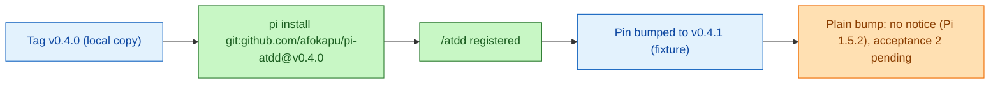

# pi-atdd 0.4.0: first versioned Pi package (ATD-20)

Tracking: Linear **ATD-20** (team ATDD), branch `feature/atd-20-publish-package`, draft PR #37. PLT-104 is the old Forge id for the same work.

## Summary

| Item | Result |
|---|---|
| `package.json` | version `0.4.0` (confirmed by the Coach); `"private": true` removed; `CHANGELOG.md` added to `files` |
| `CHANGELOG.md` | Pi format, one heading per version, newest first (`0.4.0`, `0.2.0`) |
| Included | PR #24 (PLT-105 telemetry and structural discovery) and PR #36 (ATD-24 tracker check in CI), both merged to `main` at 12:25 UTC; branch rebased on `main@origin` `96def30` |
| Acceptance 1: clean install, `/atdd` registered | **Met** (`npm run smoke:release`) |
| Acceptance 2: pin bump shows `Extension Updates` | **Pending.** Moved to a follow-up issue the Coach opens. Pi 1.5.2 keys notices by source incl. `@ref`, so a plain pin bump is silent. No workaround is built. |
| Licences | recorded below (facts) |
| Profiles | not touched; still on the local folder (owner approval per profile) |
| Merge / tag | none. PR #37 stays draft; independent review pending. |



## Versioning

- Tag `v0.3.0` already exists on `origin` at `9c9593b` (PR #26), but that commit's `package.json` still says `0.2.0`. Tags are not moved or pushed, so this release is `0.4.0`, the first version whose `package.json` matches its tag. Confirmed by the Coach.
- No tag is pushed. The install proof uses a local tag in a throwaway copy.

## Finding: Pi 1.5.2 keys the changelog notice by source including the ref

Pi stores the "last seen" version per package in `extensionChangelogVersions`, under the key `getSourcePackageKey` (`dist/core/source-info.js`):

```text
JSON.stringify({ source: identity.source, scope: identity.scope })
```

`identity.source` is the full spec, including `@v0.4.0`. A pin bump therefore creates a new key. On the first start with a new key, Pi takes the "fresh install" branch: it records the version and shows nothing. Verified in the smoke: after the bump, the checkout moved to `v0.4.1` and no notice was shown.

Consequence: a profile that bumps its pin by tag does not see the "Extension Updates" notice in Pi 1.5.2. This is acceptance 2, **pending** in a follow-up issue. The smoke asserts the silence, so a change in Pi is noticed. No workaround is built.

## Licences

Checked on 2026-11-22 against the revisions pinned in `vendor/catalog.lock.json`. These are recorded facts; no licence was added to any repository by this change.

| Vendored source | Pinned revision | Licence found | Evidence |
|---|---|---|---|
| `vendor/atdd-bun` (356 conventions, `relationships.yaml`) | `5945d97e18310e7c862c08e73985400935d21346` | **None.** No LICENSE, COPYING or NOTICE file at that revision; GitHub reports no licence. | `git ls-tree` at the revision; `gh api repos/afokapu/atdd-bun/license` returns 404. The owner owns this repository and approved shipping `vendor/atdd-bun` inside the package. |
| `vendor/atdd-flow` (2 conventions) | `2a66019a5ecf2b7a9f999ebfa04d04c9f548f19a` | MIT License, Copyright (c) 2026 Alec Fokapu | LICENSE file at the revision; GitHub reports `MIT` (SPDX). The notice is now shipped as `vendor/atdd-flow/LICENSE`, a byte-identical copy of the pinned upstream file (added after reviewer R2; checked by `tests/release-package.test.ts`). |
| pi-atdd itself (this repo) | this release | No `license` field in `package.json`; no LICENSE file | `git ls-files` |

## Install proof (ATD-20 acceptance 1 and 2)

`npm run smoke:release` runs real Pi in an isolated `PI_CODING_AGENT_DIR` and `HOME`:

1. Install `git:github.com/afokapu/pi-atdd@v0.4.0` in a clean profile. `/atdd` is registered (RPC `get_commands`). **Met.**
2. The first interactive start records the version silently (no notice). **Met.**
3. Bump the pin to `v0.4.1` (a fixture tag with a changelog entry) and reconcile with `pi update --extensions`. The checkout moves to `v0.4.1`; no notice appears. **Pending** (finding above).

The git source is the spec profiles would use. GitHub is redirected to a local copy of `HEAD` through an isolated `GIT_CONFIG_GLOBAL`. The copy carries local tags only, so nothing is pushed. The real `~/.pi/agent/settings.json` is checked to be unchanged. The interactive runs use Python's stdlib `pty` (needs `python3`).

## Open items

- **Acceptance 2** (pin bump notice): pending follow-up issue, opened by the Coach. No workaround.
- **Independent review** of PR #37 by the Reviewer tab (ATD-20) before any merge decision.
- **Profiles**: Forge, AF8 and Pluggy still load the local folder. Switching each profile to `git:github.com/afokapu/pi-atdd@v0.4.0` needs owner approval per profile.

## Checks

- `npm run check` (typecheck and unit tests, including `tests/release-package.test.ts`).
- `npm run smoke:release`, `smoke:install`, `smoke:bundle`, `smoke:pi`, `smoke:attention`, `smoke:renewal`, and `smoke:catalog` (against the pinned upstream revisions).
