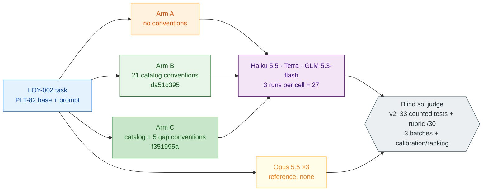
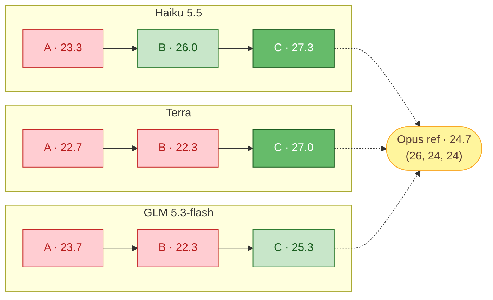
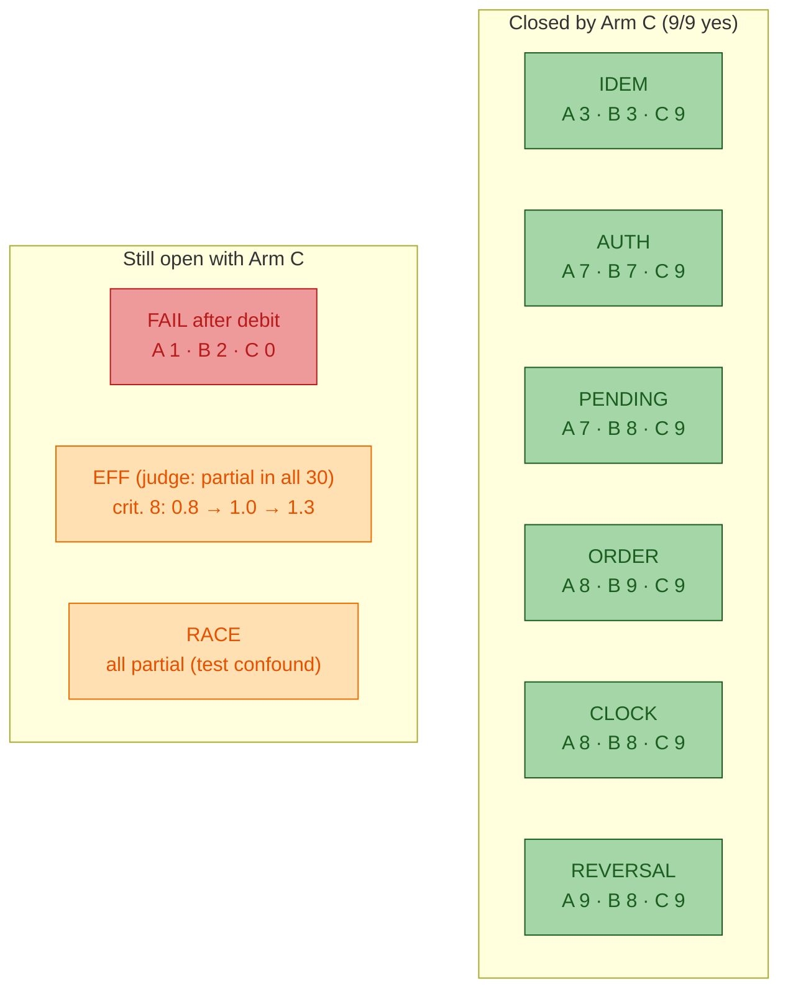
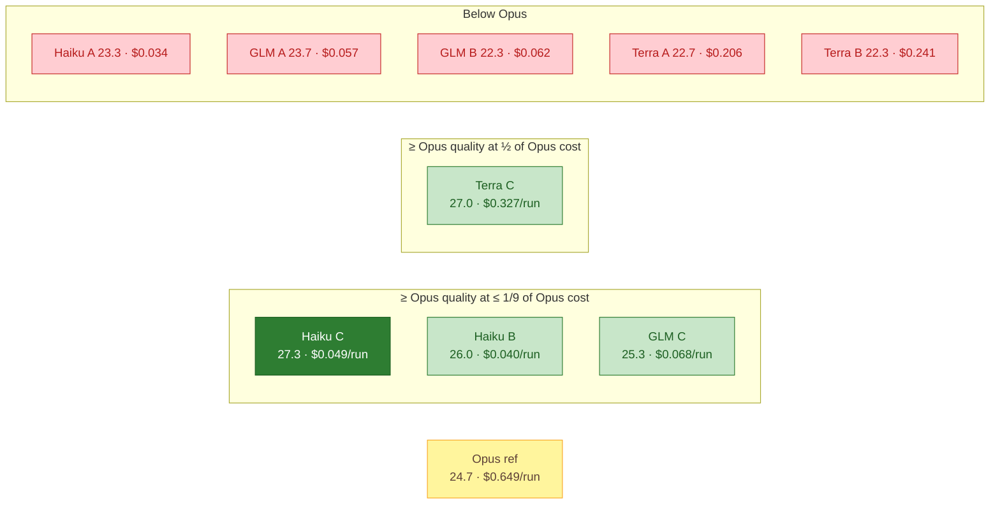

# PLT-85 — Gap check round 2: replicated hard task, harder tests, gap-filling conventions

**Scope.** Qualitative, n = 3 per cell, one blind judge (`openai-codex/gpt-6.1-sol`). It uses the same LOY-002 task, base (`4b404362`), prompt (`7aa2e96f…`) and Pi flags as PLT-82; only the delivered conventions vary.
- **Arm C is a declared best case:** its 5 gap conventions were written knowing PLT-82's uncovered traps.
- The v2 hidden tests target the same gaps.

Full tables: `RESULTS.md`, generated by `harness/compare.mjs`. Raw aggregates: `results.json`.

## Design as run

**Shared setup**
- 30 fresh, isolated Pi sessions with PLT-82's flags, thinking `medium` and a 30-minute cap. At most 10 ran at once: Claude 4, Codex 4, Z.ai 3.
- Order was counterbalanced: each replicate rotates the arm order per model (A,B,C → B,C,A → C,A,B).
- First-turn prompt sizes confirm each arm received exactly its file: Haiku 3.4k / 16.0k / 19.7k tokens for A / B / C, Terra 1.4k / 9.0k / 11.3k.
- **No VOID runs.** No quota errors, no timeouts and no model substitutions.

**Arm C conventions.** The 5 ids are `money-integer-minor-units-adjustment-order`, `idempotent-replay-stored-result`, `atomic-check-and-debit-async-store`, `compensating-reversal-original-entries` and `indexed-lookup-no-history-scan`, all under `coder.bun.`.
- Format: PLT-81, author `pi-claude-cli/claude-opus-5-5`, auditor `gpt-6.1-sol`.
- They are written as general rules: the forbidden-token check passed, and the examples use neutral domains (balances, stock, invoices).
- All 5 PASS, after 2–3 audit rounds.
- Evidence: `conventions/gap-fleet/`, `conventions/gap-selection.json`.

**Evaluator v2.** A fresh sol session wrote it blind, before any coder run. `MANIFEST.json` sha256 is `60ab6586…`.
- 33 counted tests, all v1 traps plus two new ones: **T-FAIL** (failure after debit) and **T-EFF** (store-record budget, now counted).
- Validation: base 0/33; correct reference 33/33 (5 runs in a row); naive reference 16/33; 7 single-defect variants each fail only their targeted tests.
- The rubric is v1's 10 criteria (0–3, total /30), with failure atomicity added to criterion 4.
- Grading ran in 3 blind batches, one per replicate. Each batch holds one run of every model × arm cell plus one Opus run, under shuffled opaque ids.
- A 4th sol session calibrated the scores across batches (17 criterion corrections, each with code evidence) and produced the frozen lexicographic ranking.
- Judge and operator hidden-test counts agree on all 30 runs.

### Deviations and caveats (stated plainly)

1. **The T-RACE hidden tests are confounded.** All 4 read the points applied from `GET /orders/:id/quote` after the race.
   - The task only requires the **redeem response** to return the quote, so this is a contract the task does not specify.
   - Every cheap-model run fails all 4 because its GET quote stays points-free. Every Opus run passes them, which is 12/12 against 0/12.
   - In the judge's supplemental yielding-conservation probes, the cheap runs conserved points (no double spend).
   - So the **hidden totals favour Opus by about 4 tests**. Hidden counts excluding T-RACE are reported alongside the raw counts.
   - The lexicographic ranking puts counted passes first, so it inherits the bias. The **calibrated rubric is the primary quality measure** here.
2. **"Opus-level"** means a calibrated rubric of **≥ 24**, the median of the 3 Opus runs (26, 24, 24).
3. **Cost** is Pi's nominal per-run `usage.cost`. All providers are subscriptions, and Z.ai billing is unconfirmed.
4. **The judge is not perfectly arm-blind.** Code written under Arm C can echo convention vocabulary in comments. Explicit identifiers were redacted.

## Results per model: A / B / C / Opus

| Model | Arm | Hidden /33 (excl. RACE /29) | Rubric /30 mean ± SD (runs) | Opus-level | Pi cost / run | Cost per Opus-level result |
| -- | -- | -- | -- | -- | -- | -- |
| Haiku 5.5 | A none | 26.7 (26.7) | 23.3 ± 0.6 (23, 23, 24) | 1/3 | $0.034 | $0.101 |
| | B catalog | 27.0 (27.0) | 26.0 ± 1.0 (26, 27, 25) | 3/3 | $0.040 | $0.040 |
| | **C catalog+gap** | 27.0 (27.0) | **27.3 ± 0.6** (28, 27, 27) | 3/3 | $0.049 | **$0.049** |
| Terra | A none | 27.7 (27.3) | 22.7 ± 0.6 (23, 23, 22) | 0/3 | $0.206 | — |
| | B catalog | 28.0 (28.0) | 22.3 ± 1.2 (23, 23, 21) | 0/3 | $0.241 | — |
| | **C catalog+gap** | 28.3 (28.3) | **27.0 ± 0.0** (27, 27, 27) | 3/3 | $0.327 | **$0.327** |
| GLM 5.3-flash | A none | 25.3 (25.3) | 23.7 ± 2.1 (23, 26, 22) | 1/3 | $0.057 | $0.171 |
| | B catalog | 26.0 (26.0) | 22.3 ± 1.5 (21, 22, 24) | 1/3 | $0.062 | $0.186 |
| | **C catalog+gap** | 26.3 (26.3) | **25.3 ± 1.5** (24, 25, 27) | 3/3 | $0.068 | **$0.068** |
| **Opus 5.5 (ref)** | none | 30.3 (26.3) | 24.7 ± 1.2 (26, 24, 24) | 3/3 | $0.649 | $0.649 |

Pooled over the 3 cheap models (n = 9 per arm):

| Arm | Rubric | Opus-level runs | Cost / run | Cost per Opus-level result |
| -- | -- | -- | -- | -- |
| A | 23.2 ± 1.2 | 2/9 | $0.099 | $0.445 |
| B | 23.6 ± 2.1 | 4/9 | $0.114 | $0.257 |
| C | 26.6 ± 1.2 | **9/9** | $0.148 | **$0.148** |

Calibrated rubric means /30. Red is below the Opus mean, light green above it, dark green at least 2 points above it.

## Trap coverage by arm (judge verdicts, “yes” runs out of 9 cheap-model runs)

| Trap | A | B | C | Opus (of 3) | Covered by a gap convention? |
| -- | -- | -- | -- | -- | -- |
| ORDER (order / rounding) | 8 | 9 | 9 | 3 | yes (money) |
| LOTS | 9 | 9 | 9 | 3 | — |
| IDEM (stored replay, re-auth, mismatch) | 3 | 3 | **9** | 1 | yes (idempotent-replay) |
| RACE | 0 (9 P) | 0 (8 P, 1 N) | 0 (9 P) | 3 | yes (atomic-check-and-debit) |
| REVERSAL + expiry | 9 | 8 | 9 | 3 | yes (compensating-reversal) |
| AUTH / ownership | 7 | 7 | **9** | 1 | partly (re-auth on replay) |
| PENDING | 7 | 8 | **9** | 3 | partly (re-validate in critical section) |
| CLOCK | 8 | 8 | 9 | 3 | partly (injected clock at reversal) |
| FAIL (failure after debit) | 1 | 2 | **0** | 0 | yes (atomic-check-and-debit) |
| EFF (store-record budget) | 0 | 0 | 0 | 0 | yes (indexed-lookup) |

The "partial" verdicts on RACE stem from the confounded GET-quote tests: supplemental probes show the cheap runs conserving points under concurrency. Rubric criterion 4 (concurrency + failure atomicity) is 2.0 for every arm and for Opus.

## Cost vs quality

| Cell | Pi cost per Opus-level result | × Opus |
| -- | -- | -- |
| Haiku B | $0.040 | 0.06 |
| Haiku C | $0.049 | 0.08 |
| GLM C | $0.068 | 0.10 |
| Terra C | $0.327 | 0.50 |
| Opus | $0.649 | 1.00 |

Arm C costs more than Arm A per run, from the longer system prompt and longer sessions:

| Model | Cost per run A → C | Tokens per run, C vs A |
| -- | -- | -- |
| Haiku | +44% ($0.034 → $0.049) | 2.2× |
| Terra | +59% ($0.206 → $0.327) | 2.5× |
| GLM | +19% ($0.057 → $0.068) | 1.1× |

Even so, every C cell is cheaper per Opus-level result than its own A cell, and much cheaper than Opus.

Total Pi cost of the experiment:

| Item | Pi cost |
| -- | -- |
| 30 coder runs | $5.19 (Opus $1.95, cheap $3.25) |
| Gap-convention authoring + audit | $2.34 |
| Evaluator: authoring $0.57, 3 verdict batches $2.44, calibration/ranking $0.76 | $3.78 |
| Qualification | about $0.03 |

## Verdict

**Did the catalog conventions (Arm B) replicate PLT-82? Only for Haiku.**
- Haiku: 23.3 → 26.0. All 3 B runs reached Opus level, against 1/3 without conventions, at +18% cost. This replicates PLT-82's Haiku result in direction and size.
- Terra did not replicate: 22.7 → 22.3. PLT-82's Terra +1 was within noise.
- GLM went down: 23.7 → 22.3. It regressed on IDEM (2 → 0 yes runs) and AUTH (3 → 1), and its report honesty fell to 1.7.
- Pooled B vs A is +0.4. **The catalog-only effect is model-dependent, not general.**

**Did the gap conventions (Arm C) close the uncovered traps?**
- **They closed the decision-type traps, but not the mechanism-type traps.**
- **Closed:**
  - IDEM went from 3/9 to 9/9 yes runs: stored replay, re-authorisation and mismatch.
  - AUTH, PENDING, CLOCK and ORDER reached 9/9.
- **Result:** every C cell scored above the Opus mean of 24.7: Haiku 27.3, Terra 27.0, GLM 25.3. All 9 C runs reached Opus level, against 2/9 for A and 4/9 for B. Terra gained most, +4.3, after the catalog alone did nothing for it.
- **Not closed:**
  - **Failure after debit (T-FAIL):** 0/9 C runs fully handled it, against 1/9 for A.
  - **Efficiency (T-EFF):** the judge rated it partial in all 30 runs.
    - Hidden EFF tests were fully passed only by Terra: B 9/9, A 7/9, C 7/9.
    - Most other cells passed only the replay case (3/9). Haiku C reached 5/9.
    - Criterion 8 rose only from 0.8 (A) to 1.0 (B) to 1.3 (C), and no run, Opus included, scored 3.
  - **RACE:** partial everywhere, but that result is confounded (caveat 1).
- **Cost:** +19–59% per run over Arm A. Cost per Opus-level result is still $0.05–0.33 against Opus's $0.65.

**Regressions, stated plainly**
- **Haiku C vs A/B on T-FAIL:** hidden FAIL tests went from 9/9 to 7/9. One Haiku C run (`haiku-C-1`) debits before the tax lookup and does not compensate. That breaks the very `atomic-check-and-debit` convention it was given.
- **GLM C efficiency** is 0.7, below GLM B at 1.0.
- **GLM B vs A:** rubric −1.4, IDEM 2 → 0 yes runs, AUTH 3 → 1.
- **Terra B vs A:** one RACE verdict of "no", and criterion 4 fell 2.0 → 1.7.
- **Opus** handled IDEM and AUTH fully in only 1/3 runs, the same weakness as in PLT-82. Its hidden-test lead rests on the T-RACE GET-quote confound.

**Bottom line.** This is still qualitative, with n = 3, one judge and a best-case Arm C. Conventions written for the traps lifted all three cheap models to or above Opus's rubric level at 8–50% of Opus's per-run Pi cost. The catalog alone did that only for Haiku. Remaining gaps are failure atomicity and indexed data access: in all three arms the coders mostly did not implement them, even though Arm C's conventions told them to.

## Gap candidates for PLT-86 (not catalog additions)

The 5 Arm C rules are **gap candidates for PLT-86** (under PLT-84). They are not added to the catalog under `coder.bun.*`.
- The `coder.bun.*` ids were used only to deliver them in this experiment.
- PLT-86 plans to give them neutral ids, keep `coder.bun.*` as aliases, use this reviewed text verbatim as the Bun realization, and take PLT-82's stack-neutral drafts as the core.
- The frozen Arm C files are unchanged.

The trap results below cover the 9 cheap-model runs per arm, A → B → C:
- **Judge "yes":** runs the judge rated as handling the trap, out of 9.
- **Hidden tests:** passes summed over the 9 runs.
- **Rubric criterion:** mean, 0–3.

| Candidate (experiment id) | Trap(s) targeted | Judge "yes" A → B → C | Hidden tests A → B → C | Rubric criterion A → B → C | Reading |
| -- | -- | -- | -- | -- | -- |
| `money-integer-minor-units-adjustment-order` | ORDER | 8 → 9 → 9 | 35/36 → 36/36 → 36/36 | c1: 2.89 → 3.00 → 3.00 | Already near ceiling with the catalog; small effect. |
| `idempotent-replay-stored-result` | IDEM, AUTH on replay | IDEM 3 → 3 → **9**; AUTH 7 → 7 → **9** | IDEM 50/54 → 48/54 → **54/54**; AUTH 27/27 throughout | c3: 2.33 → 2.33 → **3.00** | Clearest effect: closed the trap in all 9 runs. |
| `atomic-check-and-debit-async-store` | RACE, FAIL, PENDING | RACE 0 → 0 → 0 (partial; test confound); FAIL 1 → 2 → **0**; PENDING 7 → 8 → 9 | RACE 1/36 → 0/36 → 0/36; FAIL 23/27 → 27/27 → **23/27** | c4: 2.00 → 1.89 → 2.00 | **Not effective.** Failure-after-debit got worse in one Haiku C run. Needs a sharper rule, e.g. "price/validate before debit" as its own obligation. |
| `compensating-reversal-original-entries` | REVERSAL, CLOCK | REVERSAL 9 → 8 → 9; CLOCK 8 → 8 → 9 | REVERSAL 36/36 throughout; CLOCK 18/18 throughout | c5: 2.67 → 2.67 → **3.00** | Moved the judge's scores; the hidden tests were already at ceiling. |
| `indexed-lookup-no-history-scan` | EFF | 0 → 0 → 0 (all partial) | 13/27 → 15/27 → 15/27 | c8: 0.78 → 1.00 → 1.33 | **Weak.** Coders rarely added a usable-entry index. |

## Layout

- `RESULTS.md` and `results.json`: every table, per run and per cell.
- `conventions/`:
  - `conventions.md` (Arm B) and `conventions-c.md` (Arm C);
  - `gap-selection.json`;
  - `gap-fleet/<id>/` with the spec, the author and audit rounds and the check.
- `harness/`:
  - `gap-fleet.mjs`, `render-conventions-c.mjs`;
  - `schedule.mjs`, `run-fleet.mjs`, `run-coder.mjs`;
  - `anonymise.mjs`, `curate.mjs`, `compare.mjs`.
  - It reuses `../plt-82-qual-gap/harness/pi-session.mjs` unchanged.
- `prompts/`: gap author/auditor prompts and specs, evaluator v2 authoring/verdict/ranking prompts, and the `rendered/` copies.
- `evaluator/`: the frozen v2 materials (tests, runner, rubric, validation, manifest), published after the verdicts.
- `results/<run>/`: `run.json`, `result.diff`, `report.md`, the `hidden/` mechanical run, and `evaluator/verdict.json` with probes.
- `verdicts/`: batch summaries, supplemental probes, `final/calibration.json`, `final/calibrated-scores.json` and `final/ranking.json`.
- `run/`: base SHA, prompt, manifest hash, fleet log and anonymise log.
- `qualify/`: the one-prompt qualifications.
